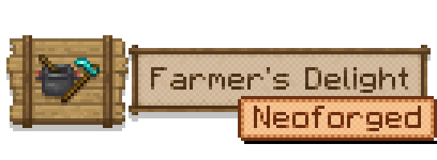
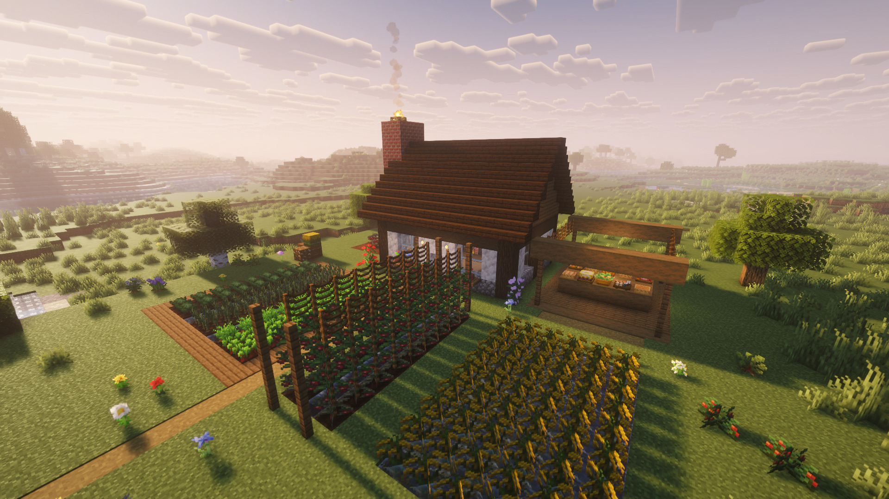

A maintained NeoForge continuation of <a href="https://www.curseforge.com/minecraft/mc-mods/farmers-delight">Farmer's Delight</a>
by <b>vectorwing</b>, a cozy farming and cooking expansion for Minecraft: cooking pots, stoves, skillets,
cutting boards, new crops, rich soil, meals and feasts.

> Independent project by **Jexxme**, not affiliated with or endorsed by vectorwing.
> Please report bugs here, not on the original Farmer's Delight tracker or
> [Discord](https://discord.gg/eFsz5SK).

## Download

| Minecraft | NeoForge |
|---|---|
| 26.3 | 26.3.0.101 or newer |
| 26.2 | 26.2.0.93 or newer |
| 26.1.2 | 26.1.2.126 or newer |
| 26.1, 26.1.1 | 26.1.0.19-beta to 26.1.1 |

## Install

1. Install [NeoForge](https://neoforged.net/) for your Minecraft version (see the table above).
2. Put the file for your Minecraft version into the `mods` folder. On a server, players need it too.
3. Coming from the original Farmer's Delight? Remove it first. Worlds and add-ons keep working, because the mod ID
   stays `farmersdelight`.

Works with JEI, REI and AppleSkin. EMI and CraftTweaker follow once they're on 26.x.

## Contributing

Bug reports and pull requests are welcome. Building, testing and how the Minecraft versions are maintained:
[CONTRIBUTING.md](CONTRIBUTING.md).

## Credits

- **vectorwing** and all [Farmer's Delight contributors](https://github.com/vectorwing/FarmersDelight/graphs/contributors):
  the original mod, its code, art, sounds and translations.
- The [Farmer's Delight Refabricated](https://github.com/MehVahdJukaar/FarmersDelightRefabricated) team
  (MehVahdJukaar, Cassian, AyOhEe and contributors) for the 26.x groundwork and the REI integration this port adapts.
- squeek502 (AppleSkin), the reference for the HUD overlay code.
- Translation updates from open upstream pull requests: mpustovoi (ru_ru, [#1396](https://github.com/vectorwing/FarmersDelight/pull/1396)),
  mykhailolyzhechko (ry_ua, [#1395](https://github.com/vectorwing/FarmersDelight/pull/1395)),
  cerealconjugo (es_mx, [#1326](https://github.com/vectorwing/FarmersDelight/pull/1326), [#1376](https://github.com/vectorwing/FarmersDelight/pull/1376)),
  Kayyz1603 (id_id, [#1350](https://github.com/vectorwing/FarmersDelight/pull/1350)),
  aleimoon (tr_tr, [#1335](https://github.com/vectorwing/FarmersDelight/pull/1335)),
  hikarosato (uk_ua, [#1331](https://github.com/vectorwing/FarmersDelight/pull/1331)),
  Bea-CEO (pt_br, [#1299](https://github.com/vectorwing/FarmersDelight/pull/1299)).

## License

[MIT](LICENSE), like the original. vectorwing's copyright notice is kept in `LICENSE` and in the jar.
"Farmer's Delight" is vectorwing's project name and is used here only to say what this continues.

Contact: Jexxme, minecraft@jeromesommerfeldt.de
