
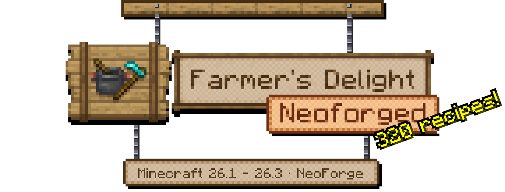

<b>Farmer's Delight lives on: crops, knives, cooking pots and feasts for Minecraft 26.1 to 26.3.</b> 
Grow the crops, cut them on a board, cook them in a pot and set a feast on the table. Farmer's Delight Neoforged is an independent NeoForge continuation of vectorwing's Farmer's Delight, made by <b>Jexxme</b> and not affiliated with or endorsed by vectorwing.

  

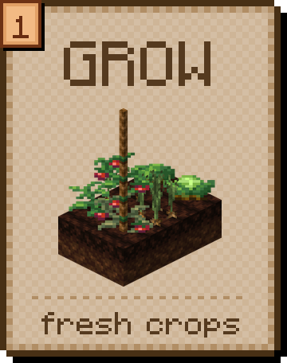 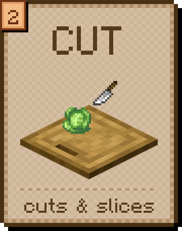 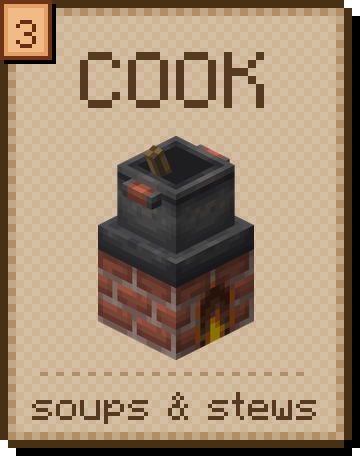 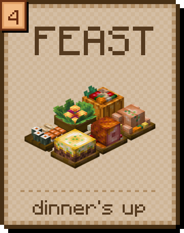

No recipe book, no magic box: it all happens out in the world. Ripe tomatoes pop off the vine, the knife cuts on the board, the stove crackles and the pot boils away until dinner is ready. Then the roast goes on the table and everyone takes a plate. And the rotten tomatoes? Those are for throwing. Pull up a chair, the stove is still warm.

The <b><a href="https://jexxme.github.io/FarmersDelight-Neoforged/">wiki</a></b> has a page for each of the 186 items, a recipe planner and a food table you can sort.

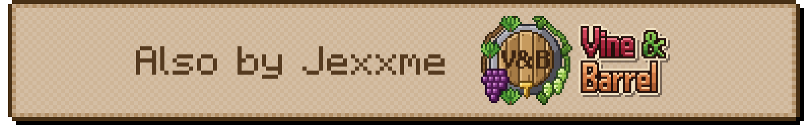

**[Vine & Barrel](https://jexxme.github.io/VineAndBarrel/)** is a cozy brewing mod: beer, wine, mead and cider. It's a separate mod for Minecraft 26.3, on NeoForge and Fabric, and works fine on its own. Install both and they fit together:

- The **Stove** heats Vine & Barrel's Brew Kettle, and so does every other heat source the pot likes.
- Grape and hop bushes climb **ropes**, and **Rich Soil** helps grapes, hops and barley grow.
- **Apple Cider** and **Melon Juice** age in its barrels into Hard Cider and Melon Wine.
- The **Cooking Pot** learns five meals: Beer-Battered Fish, Wine-Braised Beef, Cider-Braised Pork, White Wine Risotto and Barley Mutton Broth. **Coq au Vin** is a new feast: one pot serves four bowls.
- **Beer Bread** is made from wheat and a beer, and your knife gets straw from ripe barley.

<i><a href="https://jexxme.github.io/FarmersDelight-Neoforged/compatibility/#works-with-vine--barrel">More on the wiki →</a></i>

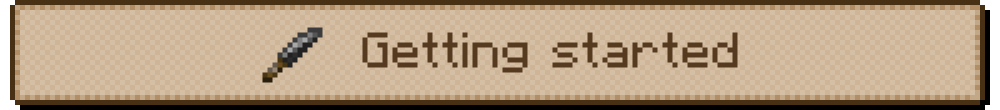

- **Find your first crops.** Seven kinds grow wild: cabbages and sea beet on beaches, onions and carrots in mild grassland, potatoes in cold taigas, tomatoes in hot, dry biomes and rice in shallow water. Break one by hand for its seeds.
- **Or raid the pantry.** Village farms grow them in every kind of village, and the wandering trader sells seeds. Village houses, shipwrecks, mineshafts and dungeons hide seeds in their chests.
- **Craft a pot, a stove, a board and a knife:**

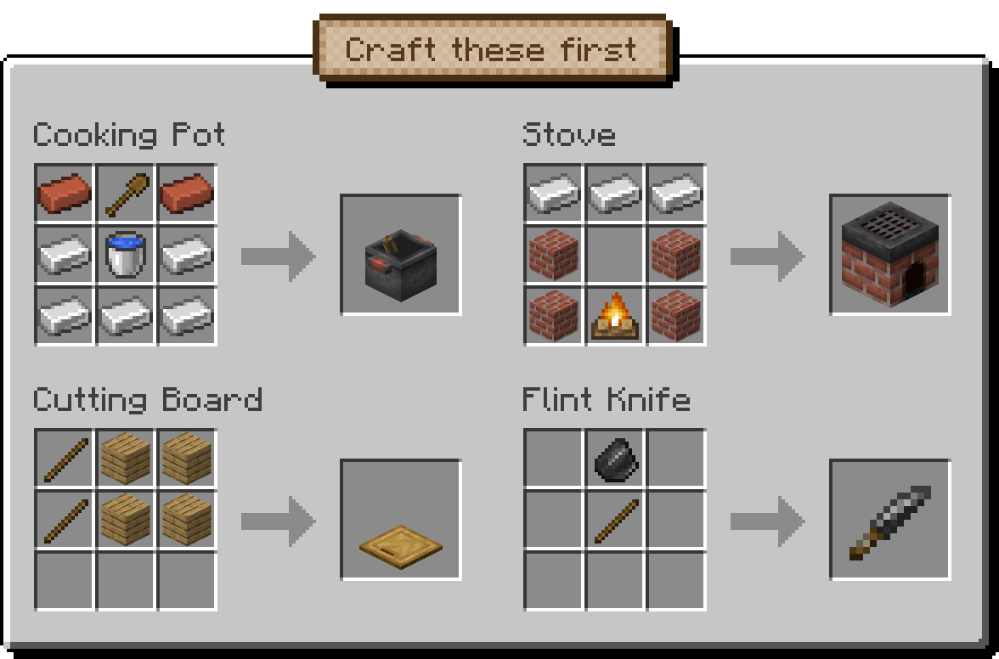

<i><a href="https://jexxme.github.io/FarmersDelight-Neoforged/guides/first-meal/">More on the wiki →</a></i>

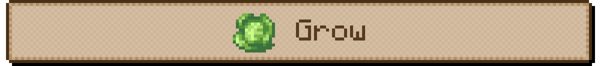

- **Cabbages and onions** grow on farmland, just like wheat. An onion is its own seed.
- **Tomatoes** start as a bush and turn into a vine you pick again and again. Give them a **Rope** and they climb it, into a whole wall of tomatoes.
- **Rice** grows in water one block deep and pushes its panicles up on top.
- **Rich Soil:** leave a block of **Organic Compost** to rot and it turns into Rich Soil, the only way to get it. Plants on it get a free bone meal now and then (a 20% chance each time the soil gets a turn), and a mushroom on it becomes a colony, in any light.
- **Straw:** break grass, ripe wheat or rice with a knife. Two straw make four rope, and four straw make a Canvas.

<i><a href="https://jexxme.github.io/FarmersDelight-Neoforged/mechanics/crops/">More on the wiki →</a></i>

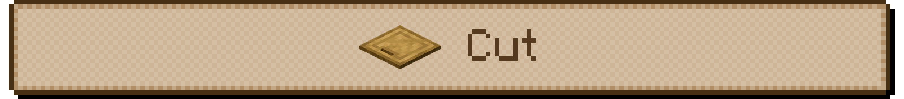

Put an ingredient on the **Cutting Board**, right-click it with a **knife**, and the pieces fall off the side.

- Raw Beef gives 2 Minced Beef, a Raw Porkchop 2 Bacon, a Cabbage 2 Cabbage Leaves and a Pumpkin 4 Pumpkin Slices. A Raw Chicken gives 2 Chicken Cuts and a bone meal for the garden.
- Wheat Dough becomes Raw Pasta. That's half of Pasta with Meatballs done.
- **Not just food.** Axes, pickaxes, shovels, hoes and shears break down logs, stone, gravel and old gear. The board has 117 recipes in all.
- **Six knives:** flint, copper, iron, golden, diamond and netherite. A knife is a quick little weapon too, and pigs drop ham when you use one.
- A dispenser facing the board uses its knife on whatever sits there. Add two hoppers and the slicing runs itself.

<i><a href="https://jexxme.github.io/FarmersDelight-Neoforged/mechanics/cutting-board/">More on the wiki →</a></i>

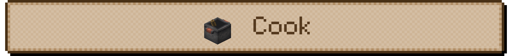

The **Cooking Pot** is the heart of your kitchen. Drop in up to six ingredients and set it on something hot: a **Stove**, a campfire, fire, lava or a magma block.

- Most meals take 10 seconds. Up to 64 servings wait in the pot until you scoop them out with their bowl or bottle.
- **The heat went out?** Nothing is lost but a little time: the ingredients wait, and the pot carries on when the fire is back.
- A hopper under the pot passes the heat up and pulls the meals out. Heat, hopper, pot: that's an automatic kitchen.
- **Stove:** a brick grill that cooks six things at once, anything a campfire can cook. Light it with flint and steel or a fire charge.
- **Skillet:** fry food right in your hand next to any heat, or set it on the heat as a small, fast grill. It doubles as a heavy weapon.

<i><a href="https://jexxme.github.io/FarmersDelight-Neoforged/mechanics/cooking-pot/">More on the wiki →</a></i>

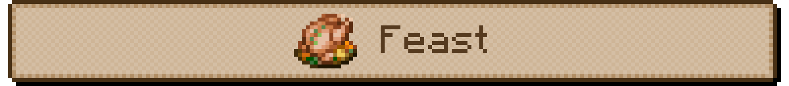

Some dishes are too big for one person. A **feast** goes on the table as a block, and everyone takes a serving.

- **Six feasts:** Roast Chicken, Stuffed Pumpkin, Honey Glazed Ham, Shepherd's Pie, Gleaming Salad and Rice Roll Medley. Bring a bowl: each serves four. The Rice Roll Medley hands out eight rolls to an empty hand.
- When the last serving is gone, most leave a plate of leftovers. Click it to clear the table.
- **Pies:** Apple Pie, Sweet Berry Cheesecake and Chocolate Pie go on the table too. Cut slices with a knife or eat straight off the plate. A vanilla Pumpkin Pie places as a pie as well.

<i><a href="https://jexxme.github.io/FarmersDelight-Neoforged/mechanics/feasts/">More on the wiki →</a></i>

**Nourishment** is the reward for a proper meal. While it lasts, your hunger bar doesn't go down, however much you run, jump or fight. Only healing still costs food.

- **You can always eat.** While you're Nourished you can eat with a full hunger bar, so top it up before it runs out.
- Feast servings give the full 5 minutes, the rolls aside. Dinner for four, sorted for a while.

<i><a href="https://jexxme.github.io/FarmersDelight-Neoforged/mechanics/effects/">More on the wiki →</a></i>

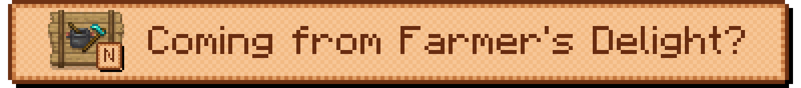

Welcome back. Farmer's Delight Neoforged has the content of Farmer's Delight 1.3.4, so if you know the original, you already know this mod.

- **Same mod ID:** still `farmersdelight`, and every item and recipe keeps its name. Your worlds, datapacks and add-ons come along for the ride, and your old config file is still read.
- **Remove the original first.** Two cooks can't share one kitchen.
- **Fixed for 26.x:** wild onions, potatoes and tomatoes grow in new worlds again. Knives lose 1 durability per hit, not 3. Milk Bottle, Hot Cocoa and Melon Juice work when you drink them, ropes reel in and ring bells again, and the Rice Roll Medley hands out its rolls.
- **Fixed from the original too:** rope fences count as fences, any fire starter lights the Stove, farmers compost cabbage and tomato seeds, and every kind of village farm grows the crops (plains and taiga farms never got cabbages).
- **New:** REI support on Minecraft 26.1.2 and newer, next to JEI.

<i><a href="https://jexxme.github.io/FarmersDelight-Neoforged/differences/">More on the wiki →</a></i>

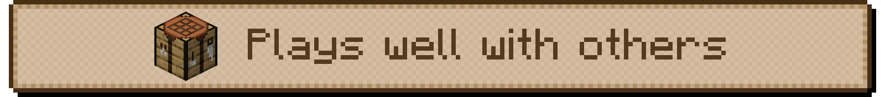

All optional. They switch on by themselves.

- **JEI:** the Cooking Pot, Cutting Board and compost recipes, the Stove and Skillet as campfire stations, and info pages. On every version.
- **REI:** the same, on Minecraft 26.1.2 and newer.
- **AppleSkin:** food values for every dish. While you're Nourished, Farmer's Delight Neoforged gilds your hunger bar itself.
- **Create**, **Immersive Engineering** and **Silent Gear:** 29 recipes of their own, from milling to the cloche. With Create, the Stove heats a steam boiler and meals stand upright on belts.
- **Serene Seasons:** each crop grows in its seasons.
- EMI and CraftTweaker pull up a seat once they're out for 26.x.

<i><a href="https://jexxme.github.io/FarmersDelight-Neoforged/compatibility/">More on the wiki →</a></i>

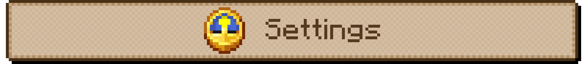

- **All in game:** on the title screen, Mods, Farmer's Delight Neoforged, Config.
- **Server owners** can switch off the villager trades, the extra chest loot, the village compost heaps and the village farm crops one by one, or change the Rich Soil chance.
- **Stackable soups:** vanilla's mushroom stew, beetroot soup and rabbit stew stack, on by default.
- **Your own screen:** hide the gilded hunger bar or the food effect tooltips.

<i><a href="https://jexxme.github.io/FarmersDelight-Neoforged/reference/config/">More on the wiki →</a></i>

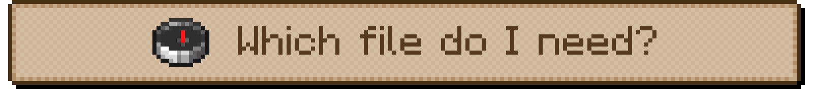

One file per Minecraft version, all with the same content. Put the same file on the server and in every player's `mods` folder.

| Minecraft | NeoForge | File |
|:--|:--|:--|
| **26.3** | 26.3.0.101 or newer | `…-26.3-1.3.4+neoforged.2.jar` |
| **26.2** | 26.2.0.93 or newer | `…-26.2-1.3.4+neoforged.2.jar` |
| **26.1.2** | 26.1.2.126 or newer | `…-26.1.2-1.3.4+neoforged.2.jar` |
| **26.1, 26.1.1** | 26.1.0.19-beta or newer, below 26.1.2 | `…-26.1.1-1.3.4+neoforged.2.jar` |

- Every row is the same release, **FD 1.3.4 (2)**: Farmer's Delight 1.3.4 content, our release 2 of it. The stores and GitHub name each file by both versions, like "MC 26.3 · FD 1.3.4 (2)".
- The file name tells you both: `FarmersDelight-Neoforged-26.3-1.3.4+neoforged.2.jar` is for Minecraft 26.3.

<i><a href="https://jexxme.github.io/FarmersDelight-Neoforged/getting-started/#install">More on the wiki →</a></i>

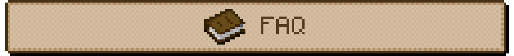

- **Is this the official Farmer's Delight?** No. Farmer's Delight is vectorwing's mod. Farmer's Delight Neoforged is an independent continuation by Jexxme, not affiliated with or endorsed by vectorwing.
- **Do my worlds and add-ons keep working?** Yes. The mod ID is still `farmersdelight`. Remove the original first.
- **Client or server?** Both. Every player needs it, and so does the server.
- **Can I use it in my modpack?** Yes, go ahead. It's MIT licensed, like the original.
- **Found a bug, or have an idea?** Open an issue on [GitHub](https://github.com/jexxme/FarmersDelight-Neoforged/issues), not on the original Farmer's Delight tracker. The [wiki](https://jexxme.github.io/FarmersDelight-Neoforged/) has every item, every recipe and every number.

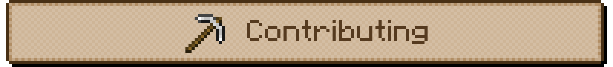

Bug reports and pull requests are welcome. Building (Java 25), testing and how the Minecraft version branches are maintained: [CONTRIBUTING.md](CONTRIBUTING.md).

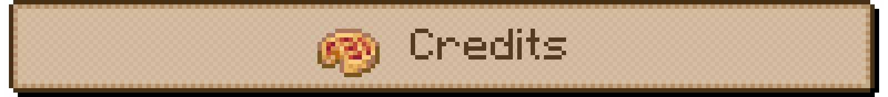

- **vectorwing** and all [Farmer's Delight contributors](https://github.com/vectorwing/FarmersDelight/graphs/contributors): the original mod, its code, art, sounds and translations. Get the original at [github.com/vectorwing/FarmersDelight](https://github.com/vectorwing/FarmersDelight).
- The [Farmer's Delight Refabricated](https://github.com/MehVahdJukaar/FarmersDelightRefabricated) team (MehVahdJukaar, Cassian, AyOhEe and contributors) for the 26.x groundwork and the REI integration this port adapts.
- **squeek502** (AppleSkin), the reference for the HUD overlay code.
- Translation updates from open upstream pull requests: mpustovoi (ru_ru, [#1396](https://github.com/vectorwing/FarmersDelight/pull/1396)), mykhailolyzhechko (ry_ua, [#1395](https://github.com/vectorwing/FarmersDelight/pull/1395)), cerealconjugo (es_mx, [#1326](https://github.com/vectorwing/FarmersDelight/pull/1326), [#1376](https://github.com/vectorwing/FarmersDelight/pull/1376)), Kayyz1603 (id_id, [#1350](https://github.com/vectorwing/FarmersDelight/pull/1350)), aleimoon (tr_tr, [#1335](https://github.com/vectorwing/FarmersDelight/pull/1335)), hikarosato (uk_ua, [#1331](https://github.com/vectorwing/FarmersDelight/pull/1331)), Bea-CEO (pt_br, [#1299](https://github.com/vectorwing/FarmersDelight/pull/1299)).

Made by **Jexxme**, an independent continuation, not affiliated with or endorsed by vectorwing. Please report bugs [here](https://github.com/jexxme/FarmersDelight-Neoforged/issues), not on the original Farmer's Delight tracker or Discord.

"Farmer's Delight" is vectorwing's project name and is used here only to say what this continues.

Contact: Jexxme, minecraft@jeromesommerfeldt.de
